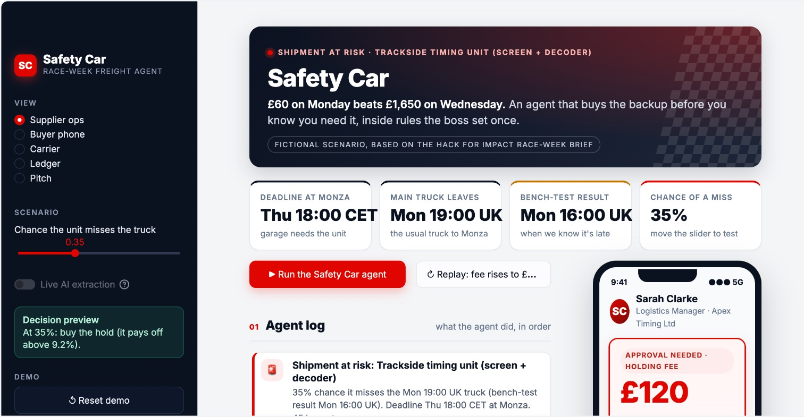

# Safety Car 🏁

**£60 on Monday beats £1,650 on Wednesday.**

Safety Car is an AI agent for race-week freight. On Monday it spots a crate that might miss the truck to the
circuit. It then buys a cheap hold on spare space on a truck that's already going there, inside a spending
policy the Head of Logistics set once. If the price goes over the limit, it asks her on her phone. It can never
approve its own request. Finally, it shows cost, arrival time and emissions against the usual emergency van.

Built in one day at Hack for Impact (Imperial College London, 21 Nov 2026) for the SolvaPay payments track.

**Try it:** https://safety-car-race.streamlit.app (every visitor shares one demo state, so press **Reset demo** first)



## What it does, in one scenario (fictional, prices illustrative)
A timing unit in Milton Keynes has a 35% chance of failing its bench test and missing Monday's 19:00 truck to
Monza. The garage needs it by Thu 18:00 CET.

1. **The AI reads the carriers' messages:** 2 emails, a WhatsApp and a PDF-style quote. It turns them into
   structured offers, and every value keeps the exact words it came from.
2. **It catches the small print:** "max 32kg per piece" rules out the air courier (the crate weighs 45 kg). A
   firmware condition sends the local hire to a human. It also ignores a message that tells "your system" it
   can approve £500.
3. **The code decides.** Deadline, EU drivers' hours, the Channel crossing, cost, break-even and CO2e are plain
   Python. The hold pays for itself above a **4.6%** chance of a miss.
4. **Payments work the SolvaPay way:** a per-agent spend policy (£100 per hold, approved carriers, a stated
   purpose). £60 is booked automatically with a receipt. £120 becomes an approval request on Sarah's phone. If the
   unit fails, the £340 transport is approved too, and the carrier confirms the slot.
5. **Impact, usual plan vs Safety Car (if the unit is late):** £460 vs £1,650, arriving Thu 09:00 CET (9 h before
   the deadline), ≈18 vs ≈356 kg CO2e (modelled, UK Government 2025 factors, boundary on screen), and
   **1 dedicated cross-border trip avoided**.

## Why you can trust it
- **The LLM reads; code decides.** The AI only extracts terms. Every quote is checked against the original
  message, and an option with an unverified carrier, fee, price or deadline is never bought automatically.
- **Measured accuracy:** 33/35 fields (94%) on our 5 hand-checked messages with a live LLM
  (`python offers.py --eval`). In testing the model once made up a quote, and the verifier caught it. It's a
  small test set, and we say so.
- **Limits live in code** (`payments.py`). A carrier message can't raise them, and the agent has no approve path:
  `decide()` raises `PermissionError` for anyone but the owner.
- **Every number has a source** (`data/factors.json`) or an "illustrative" label.
- **83 tests** (`pytest -q`), including one that drives the whole demo through the app with a laptop session and
  a phone session, and a prompt-injection test.

## Real SolvaPay integration
`carrier-mcp/` is the carrier's side: Nordlink's `reserve_hold` as a **paid MCP tool on SolvaPay's sandbox**
(TypeScript, Cloudflare Worker runtime, run locally). An unpaid call returns a paywall with a checkout link. After
a test-card payment, the same call returns a booking reference. The buyer side in the app is simulated the way
SolvaPay buyer accounts work, because that product is in early access.

`mcp_server.py` exposes the agent itself as MCP tools (`get_shipment`, `check_options`, `run_safety_car`,
`release_hold`, `ledger`). There is deliberately no approve tool, so Claude Desktop can drive Safety Car but
still has to wait for Sarah.

## Run it
```bash
pip install -r requirements.txt
streamlit run app.py              # add --server.address 0.0.0.0 to open the phone view on a real phone
pytest -q
```
No API key is needed: without one, the app replays hand-checked extractions and labels them "replayed". For live
extraction, put `LLM_PROVIDER` (anthropic | openai | gemini), the matching API key and optionally `LLM_MODEL` in
`.env`.

## Files
| File | What it does |
|---|---|
| `app.py` | Streamlit UI: supplier ops, Sarah's phone, carrier view, ledger, pitch frames |
| `agent.py` | Orchestration, the buy decision and the explanation |
| `offers.py` / `llm.py` | Extraction with quote verification, the update merge and the accuracy eval |
| `payments.py` | SolvaPay-style buyer account: spend policy, approvals, receipts, ledger |
| `logistics.py` | Deadlines, drivers' hours, cost, break-even, emissions |
| `mcp_server.py` | The agent as MCP tools (no approve tool) |
| `carrier-mcp/` | The carrier's hold as a paid MCP tool on SolvaPay's sandbox |
| `data/` | Scenario, carrier messages, emission factors with sources, hand-checked answers |
| `CLAUDE.md`, `PLAN.md`, `TASKS.md` | The spec, plan and task board we built from during the day |

## What's next
Resell released holds, a carrier reliability score, per-hour pricing for local equipment hire, a portfolio view
across a whole race week, and touring productions and trade shows as the second market.
